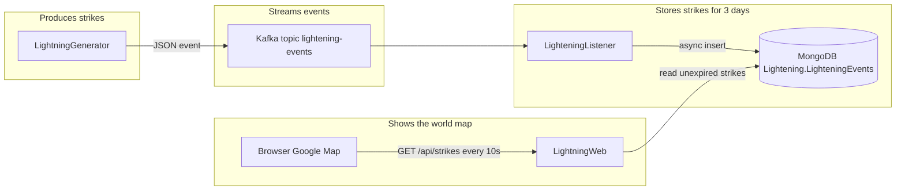

# Lightning Event Stream — Requirements

| | |
| --- | --- |
| Status | Baseline, ready to implement |
| Version | 1.1 |
| Date | 2026-11-02 |
| Audience | People reviewing the solution, and coding agents implementing it |
| Solution file | `Lightning.sln` |
| Target framework | `net10.0` (.NET 10) |

This document is the specification for a small system that invents lightning strikes, streams them through Apache Kafka, stores them in MongoDB, and shows the strikes that are still current on a Google map of the world.

---

## 1. How to read this document

People should read sections 2 through 6, then the requirement that matches the project they care about.

Coding agents should follow this order:

1. Section 5 (binding decisions) and section 6 (names and bounds). Use these values as written.
2. Section 7 (contracts). Match the field names and types exactly.
3. Section 8 for the project being implemented. Every `REQ-*` item is mandatory.
4. Section 9 before adding anything that is not listed.
5. Section 11 when a parseable summary is useful. If section 11 and an earlier section disagree, the earlier section wins.

A requirement is done only when every acceptance check under it passes. The word **SHALL** is mandatory. Do not treat a requirement as optional.

Implement one project at a time, in the order in section 10. Leave the other projects' behavior unchanged while you do.

---

## 2. Purpose

The system demonstrates a full event path:

1. `LightningGenerator` invents lightning strikes and publishes each one to Kafka until the process is stopped.
2. `LighteningListener` reads those events and stores each one in MongoDB.
3. Each stored strike expires three days after it is stored, and MongoDB removes it automatically.
4. `LightningWeb` shows a Google map of the world and refreshes the strikes from MongoDB every 10 seconds. Each strike is a circle drawn at its latitude and longitude, with its intensity printed on the circle.

An operator runs the stack locally with Docker Compose. A viewer opens the website.

Success means a strike created by the generator appears in MongoDB with the schema in section 7, and the next map refresh draws it in the right place with the right intensity. Three days later that strike is eligible for automatic removal and disappears from the map.

---

## 3. System story



A strike is born in the generator as three numbers: latitude, longitude, and intensity. Kafka carries that payload and nothing else. The listener assigns the identity, the storage time, and the expiry. The website reads the collection through its own server-side code and gives the browser a JSON list. The browser never connects to MongoDB.

The two infrastructure projects, `KafkaServer` and `MongoDBServer`, contain no application logic. Each exists in the solution to own the Dockerfile that builds that infrastructure image. `MongoDBServer` also owns the script that creates the database, the collection, and the expiry index.

---

## 4. What a person sees

1. Start the stack with Docker Compose (section 8.1).
2. Open the website. A Google map is centered on the world.
3. Within two minutes, circles start appearing. Each circle shows an intensity from 1 to 10.
4. The same page is readable on a phone and on a desktop. Strikes are listed in text as well as drawn on the map, and the layout uses flexbox so the map and the list fit the screen.
5. Leave the page open. Every 10 seconds the set of circles is replaced with the strikes still stored and not yet expired.
6. Stop the generator process. New circles stop appearing. Circles already stored remain until their expiry.
7. A strike stored at 12:00 UTC on day 0 has expiry 12:00 UTC on day 3. After that instant it is no longer returned to the map. MongoDB deletes the document automatically. Deletion can lag by about a minute because that is how the MongoDB TTL monitor works. The website query hides a document as soon as `expiry` is in the past, so the map does not wait for that lag.

---

## 5. Binding decisions

The source description used two spellings, two collection names, and two poll intervals. The choices below are the ones to implement. Change a decision here before changing code.

| ID | Choice | Why |
| --- | --- | --- |
| D-001 | The website polls every **10 seconds**. | The opening description says the web solution polls every 10 seconds. A later bullet says 30 seconds and uses the verb "pools". One interval is implemented: 10 seconds. |
| D-002 | The MongoDB collection is **`LighteningEvents`**. | The listener bullet names `LighteningEvents`. Later bullets say `LighteningEvent`. Both mean this collection. |
| D-003 | The database name is **`Lightening`**. | Named in the listener bullet. The spelling is intentional and is the stakeholder's identifier. |
| D-004 | The Kafka topic is **`lightening-events`**. | The source did not name a topic. This name follows the collection. |
| D-005 | The website project is **`LightningWeb`**. | The source asked for a website and did not name the project. |
| D-006 | Intensity is an **integer from 1 to 10 inclusive**. | The stakeholder set this scale. No unit is displayed. Values outside 1 to 10 are invalid on the Kafka message, in MongoDB, and on the website. |
| D-007 | While the generator runs, the gap between publishes is a **random value from 50 milliseconds to 120 seconds inclusive**. | "At least every 2 minutes" means a strike happens at least once per 120 seconds, so the gap is at most 120 seconds. "A maximum of 20 such events per second" means the gap is at least 50 milliseconds. The delay is drawn uniformly from that closed range on every cycle. |
| D-008 | Latitude is uniform on [-90, 90] and longitude is uniform on [-180, 180], drawn independently. | The source asks for a random strike. Polar clustering from uniform latitude is accepted. |
| D-009 | Product projects live under `src/`. Test projects are allowed and are named `<Project>.Tests`. | Keeps the five product projects exactly as named, and gives agents one place to put tests. |
| D-010 | Docker Compose runs all five parts, so the listener and the website have Dockerfiles as well as the three projects the source named. | The source requires Dockerfiles for the generator, Kafka, and MongoDB. A single local run also containerizes the listener and the website. |
| D-011 | The stored field `ID` is a lowercase UUID version 4. MongoDB `_id` is that same string. | The source asks for a random UUID called `ID`. Using it as `_id` keeps one identity. |
| D-012 | `expiry` is an absolute UTC instant, `timestamp` plus 72 hours. The collection has a TTL index on `expiry` with `expireAfterSeconds: 0`. | The source asks for an expiry three days in the future and for automatic removal. A TTL index removes a document when the indexed date is reached only if `expireAfterSeconds` is 0. |
| D-013 | `GOOGLE_MAPS_API_KEY` is supplied by the operator through the environment. It is not committed. | The map uses Google Maps. The key is an external dependency, not a value this repository invents. |

---

## 6. Normative names and bounds

Agents use these identifiers exactly. Do not rename `LighteningListener`, the database, or the collection to the dictionary spelling "lightning".

### 6.1 Repository

```
Lightning.sln
docker-compose.yml
Requirements.md
src/LightningGenerator/              application + Dockerfile
src/LightningGenerator.Tests/
src/KafkaServer/                     Dockerfile only, no C# logic
src/LighteningListener/              application + Dockerfile
src/LighteningListener.Tests/
src/MongoDBServer/                   Dockerfile + init script, no C# logic
src/LightningWeb/                    application + Dockerfile
src/LightningWeb.Tests/
```

`Requirements.md` stays at the repository root.

### 6.2 Projects

| Project | Kind | TFM | Responsibility |
| --- | --- | --- | --- |
| `LightningGenerator` | Console executable | `net10.0` | Invent strikes and publish them to Kafka until stopped. |
| `KafkaServer` | Project with no application code | `net10.0` | Dockerfile for a single-node Apache Kafka broker. |
| `LighteningListener` | Console executable | `net10.0` | Consume strikes and insert them into MongoDB until stopped. |
| `MongoDBServer` | Project with no application code | `net10.0` | Dockerfile for MongoDB and the init script for `LighteningEvents`. |
| `LightningWeb` | ASP.NET Core web app | `net10.0` | World map, poll, and the HTTP read API. |

Test projects use the same TFM and xUnit. They are not product projects.

### 6.3 Runtime names

| Item | Value |
| --- | --- |
| Kafka compose service | `kafka` |
| Kafka host port | `9092` |
| Bootstrap inside Compose | `kafka:9092` |
| Bootstrap from the host | `localhost:9092` |
| Topic | `lightening-events` |
| Topic partitions | `1` |
| Topic replication factor | `1` |
| Consumer group | `lightening-listener` |
| MongoDB compose service | `mongodb` |
| MongoDB host port | `27017` |
| Database | `Lightening` |
| Collection | `LighteningEvents` |
| TTL index name | `expiry_ttl` |
| Generator compose service | `lightning-generator` |
| Listener compose service | `lightening-listener` |
| Website compose service | `lightning-web` |
| Website host port | `8080` |
| Strikes URL | `GET /api/strikes` |
| Map page URL | `GET /` |
| Health URL | `GET /health` |
| Poll interval | `10` seconds |

### 6.4 Bounds

| Bound | Value |
| --- | --- |
| Latitude | `-90` to `90` inclusive, decimal degrees |
| Longitude | `-180` to `180` inclusive, decimal degrees |
| Intensity | integers `1` to `10` inclusive |
| Layout breakpoint | `768` CSS pixels. Below this, the map and strike list stack. At this width and above, they sit side by side. |
| Viewports to check | `320`, `768`, and `1280` CSS pixels wide |
| Inter-event delay | `50` to `120000` milliseconds inclusive, uniform |
| Event lifetime | `72` hours from `timestamp` |
| Map center | latitude `0`, longitude `0` |
| Map zoom | `2` |
| API/page clock tolerance in tests | `2` seconds |

### 6.5 Environment variables

| Variable | Used by | Default in committed config |
| --- | --- | --- |
| `KAFKA_BOOTSTRAP_SERVERS` | Generator, listener | `localhost:9092` for host runs. Compose sets `kafka:9092`. |
| `KAFKA_TOPIC` | Generator, listener | `lightening-events` |
| `KAFKA_GROUP_ID` | Listener | `lightening-listener` |
| `MONGODB_CONNECTION_STRING` | Listener, website | `mongodb://localhost:27017` for host runs. Compose sets `mongodb://mongodb:27017`. |
| `MONGODB_DATABASE` | Listener, website | `Lightening` |
| `MONGODB_COLLECTION` | Listener, website | `LighteningEvents` |
| `GOOGLE_MAPS_API_KEY` | Website | None. Empty when unset. |

Committed configuration may contain the localhost defaults. It SHALL NOT contain a real Google Maps key, a production connection string, or a password.

---

## 7. Contracts

### 7.1 Kafka message

The generator publishes one JSON object per strike as the message value. Encoding is UTF-8. There is no schema registry, and no message key is required.

```json
{
  "latitude": 51.5074,
  "longitude": -0.1278,
  "intensity": 7
}
```

| Field | JSON type | Rule |
| --- | --- | --- |
| `latitude` | number | `-90` through `90`. |
| `longitude` | number | `-180` through `180`. |
| `intensity` | number | Integer `1` through `10`. |

The object has these three fields and no others. It does not carry `ID`, `timestamp`, or `expiry`. Those are created by the listener.

### 7.2 MongoDB document

Database `Lightening`, collection `LighteningEvents`.

```json
{
  "_id": "3f1c0a2e-7b4d-4e1a-8c3d-9a0b1c2d3e4f",
  "ID": "3f1c0a2e-7b4d-4e1a-8c3d-9a0b1c2d3e4f",
  "latitude": 51.5074,
  "longitude": -0.1278,
  "intensity": 7,
  "timestamp": "2026-11-02T12:00:00.000Z",
  "expiry": "2026-11-05T12:00:00.000Z"
}
```

| Field | BSON type | Rule |
| --- | --- | --- |
| `_id` | string | Same value as `ID`. |
| `ID` | string | UUID version 4, canonical lowercase `8-4-4-4-12`. |
| `latitude` | double | Copied from the Kafka message. |
| `longitude` | double | Copied from the Kafka message. |
| `intensity` | int | Copied from the Kafka message. |
| `timestamp` | datetime, UTC | Clock time when the listener builds the document. |
| `expiry` | datetime, UTC | `timestamp` plus 72 hours. |

Index `expiry_ttl` is a TTL index on `expiry` with `expireAfterSeconds` equal to `0`.

### 7.3 HTTP `GET /api/strikes`

Response `200` with a JSON array, newest `timestamp` first. Each element:

```json
{
  "id": "3f1c0a2e-7b4d-4e1a-8c3d-9a0b1c2d3e4f",
  "latitude": 51.5074,
  "longitude": -0.1278,
  "intensity": 7,
  "timestamp": "2026-11-02T12:00:00.000Z",
  "expiry": "2026-11-05T12:00:00.000Z"
}
```

The array contains every document whose `expiry` is strictly after the server's current UTC time, and no other document. Timestamps are ISO-8601 UTC. The HTTP field is `id` (lowercase) and carries the document `ID`.

When MongoDB cannot be read, the response is `503` with a JSON object `{ "error": "strikes-unavailable" }`.

`GET /health` returns `200` with body `ok` when the website process is serving. It does not check MongoDB.

### 7.4 Who talks to what

| Project | Kafka publish | Kafka consume | MongoDB write | MongoDB read | HTTP |
| --- | --- | --- | --- | --- | --- |
| `LightningGenerator` | Yes | No | No | No | No |
| `KafkaServer` | No | No | No | No | No |
| `LighteningListener` | No | Yes | Yes | No | No |
| `MongoDBServer` | No | No | Init script only | No | No |
| `LightningWeb` | No | No | No | Yes | Yes |

---

## 8. Requirements

### 8.1 Solution

#### REQ-SOL-001 — Five product projects

The solution SHALL contain exactly these product projects, under the paths in section 6.1: `LightningGenerator`, `KafkaServer`, `LighteningListener`, `MongoDBServer`, and `LightningWeb`.

The solution SHALL also contain `Lightning.sln` at the repository root, listing those projects. Test projects named `LightningGenerator.Tests`, `LighteningListener.Tests`, and `LightningWeb.Tests` are allowed. Any other project is not allowed.

**Acceptance**

- `Lightning.sln` lists the five product projects.
- Each product project directory exists at the path in section 6.1.
- No extra product project exists.

#### REQ-SOL-002 — .NET 10

Every C# project SHALL target `net10.0`. Application code SHALL be C#. The website's browser assets SHALL be HTML, CSS, and JavaScript served by `LightningWeb`.

**Acceptance**

- Every `.csproj` contains `<TargetFramework>net10.0</TargetFramework>`.
- `dotnet build Lightning.sln` completes with no errors.

#### REQ-SOL-003 — Tests

`dotnet test Lightning.sln` SHALL pass. Each acceptance check in this document that says "automated test" SHALL exist as an xUnit test.

**Acceptance**

- `dotnet test Lightning.sln` exits 0.

#### REQ-SOL-004 — One local stack

A `docker-compose.yml` at the repository root SHALL build and start `kafka`, `mongodb`, `lightning-generator`, `lightening-listener`, and `lightning-web`.

`mongodb` SHALL become healthy before `lightening-listener` and `lightning-web` start their work. `kafka` SHALL become healthy before `lightning-generator` and `lightening-listener` start their work. Generator, listener, and website containers SHALL restart unless stopped.

MongoDB data SHALL be stored on a named volume so the init script runs on the first start and stays in place across container restarts.

**Acceptance**

- `docker compose up --build -d` from a clean volume starts all five services.
- After the health checks pass, `localhost:9092`, `localhost:27017`, and `localhost:8080` accept connections.
- `GET http://localhost:8080/health` returns `200` and `ok`.

#### REQ-SOL-005 — Configuration and secrets

Each application SHALL read the variables in section 6.5. Host defaults SHALL work for `dotnet run` against Kafka and MongoDB published on localhost. Compose SHALL override the bootstrap server and the MongoDB connection string with the in-network host names.

**Acceptance**

- A search of tracked files finds no Google Maps API key value.
- Committed defaults match section 6.5.
- The browser payload for `/` and `/api/strikes` does not contain `MONGODB_CONNECTION_STRING` or the MongoDB host.

#### REQ-SOL-006 — Logs

When a requirement says an error is logged, the process SHALL write that error to standard error or standard output so `docker compose logs` shows it. The process SHALL keep running after that log line unless the requirement says it exits.

**Acceptance**

- Automated tests cover the poison-message and unavailable-dependency paths in REQ-GEN-006, REQ-LIS-006, and REQ-LIS-007 by asserting the process outcome. Log text is inspected in those tests only to the extent the test host captures it.

---

### 8.2 LightningGenerator

Console application. It publishes strikes until the operating system asks it to stop.

#### REQ-GEN-001 — Run until stopped

WHILE the process is running, THE SYSTEM SHALL publish strikes on each elapsed delay. WHEN the process receives Ctrl+C, SIGINT, or SIGTERM, THE SYSTEM SHALL stop publishing and exit with code 0.

**Acceptance**

- Start the process. It is still running 5 seconds later.
- Signal it to stop. It exits with code 0.
- An automated test covers the cancellation path with a cancelled token or equivalent stop signal, and asserts that the loop ends.

#### REQ-GEN-002 — Random strikes inside the bounds

Each published strike SHALL draw latitude, longitude, and intensity independently.

- Latitude is uniform on [-90, 90].
- Longitude is uniform on [-180, 180].
- Intensity is a uniform integer on [1, 10].

The same random seed SHALL reproduce the same sequence. The bounds SHALL be the constants in section 6.4.

**Acceptance — automated test**

- 10,000 seeded draws all fall inside the three closed ranges.
- Intensity values are whole numbers.
- Two runs with the same seed match.
- Two runs with different seeds differ.
- The named constants equal `-90`, `90`, `-180`, `180`, `1`, `10`.

#### REQ-GEN-003 — Rate

WHILE the process is running, THE SYSTEM SHALL draw the delay until the next publish uniformly from 50 milliseconds through 120,000 milliseconds inclusive, and SHALL wait that long between publishes. The first publish SHALL happen within 120 seconds of start.

**Acceptance — automated test**

- 10,000 seeded delay draws all lie on [50, 120000].
- The named constants equal `50` and `120000`.
- The same seed reproduces the same delays.

**Acceptance — demonstration**

- A running generator publishes at least one message within 120 seconds.

#### REQ-GEN-004 — Publish the contract

WHEN a strike is produced, THE SYSTEM SHALL publish one UTF-8 JSON message to `lightening-events` that matches section 7.1.

**Acceptance — automated test**

- A captured publish of latitude `51.5074`, longitude `-0.1278`, and intensity `7` is the JSON object in section 7.1 and has no extra fields.
- Latitude `90`, `-90` and longitude `180`, `-180` are accepted by the payload builder.
- Intensity `1` and `10` are accepted.
- Latitude `90.0001`, longitude `180.0001`, and intensity `0`, `11`, and `7.5` are rejected by the payload builder and are not published.

#### REQ-GEN-005 — Kafka settings

The generator SHALL publish to the bootstrap servers and topic from section 6.5. It SHALL NOT consume, and it SHALL NOT open a MongoDB connection.

**Acceptance**

- Automated test or inspection shows the producer is the only Kafka client in this project.
- Inspection of the project file and sources shows no MongoDB driver package.

#### REQ-GEN-006 — Kafka unavailable

IF Kafka cannot accept a publish, THEN THE SYSTEM SHALL log the failure, keep the process running, and retry. The wait before a retry SHALL be from 1 second through 30 seconds inclusive. WHEN Kafka accepts publishes again, THE SYSTEM SHALL resume within one inter-event delay of the next attempt.

**Acceptance — automated test**

- A failed publish does not throw out of the host and does not exit the loop.
- The retry wait used for that failure is inside 1 to 30 seconds inclusive.

#### REQ-GEN-007 — Minimal container

`src/LightningGenerator/Dockerfile` SHALL build a container image with a multi-stage build. The build stage SHALL use `mcr.microsoft.com/dotnet/sdk:10.0`. The final stage SHALL use `mcr.microsoft.com/dotnet/runtime:10.0`, SHALL NOT include the SDK, and SHALL start the generator as the container entrypoint.

**Acceptance**

- `docker build` of that Dockerfile succeeds.
- The final image runs the generator process.
- The final image does not contain the SDK stage as its base.

---

### 8.3 KafkaServer

#### REQ-KAF-001 — Empty project

`KafkaServer` SHALL be a project in the solution with a project file and no C# application types. Its deliverable is the Dockerfile. `dotnet build Lightning.sln` SHALL still succeed.

**Acceptance**

- `src/KafkaServer` contains no `.cs` files.
- The project is listed in `Lightning.sln`.
- `dotnet build Lightning.sln` exits 0.

#### REQ-KAF-002 — Single Kafka broker

`src/KafkaServer/Dockerfile` SHALL create an image that runs the official Apache Kafka image in KRaft mode as a single broker. The listener SHALL be reachable at `kafka:9092` from other Compose services and at `localhost:9092` from the host.

**Acceptance — demonstration**

- After Compose is healthy, a client on the host using `localhost:9092` can list topics.
- A client on the Compose network using `kafka:9092` can list topics.

#### REQ-KAF-003 — Topic exists

WHEN the broker becomes ready, THE SYSTEM SHALL ensure topic `lightening-events` exists with 1 partition and replication factor 1.

**Acceptance — demonstration**

- After the Kafka health check passes, the topic list includes `lightening-events` with 1 partition and replication factor 1.
- Starting the stack a second time does not fail when the topic is already present.

---

### 8.4 LighteningListener

Console application. It consumes `lightening-events` until the operating system asks it to stop, and it inserts each valid strike asynchronously into MongoDB.

#### REQ-LIS-001 — Run until stopped

WHILE the process is running, THE SYSTEM SHALL keep consuming. WHEN the process receives Ctrl+C, SIGINT, or SIGTERM, THE SYSTEM SHALL stop consuming and exit with code 0.

**Acceptance**

- Automated test: a cancelled token ends the consume loop.
- Demonstration: the container stays up until it is stopped, then exits 0.

#### REQ-LIS-002 — Consume the topic

The listener SHALL consume topic `lightening-events` with group id `lightening-listener`, using the settings in section 6.5. It SHALL NOT publish strikes and SHALL NOT invent latitude, longitude, or intensity.

**Acceptance**

- Inspection shows a consumer and no producer in this project.
- Automated test: the consumer is configured with topic `lightening-events` and group `lightening-listener`.

#### REQ-LIS-003 — Store the document

WHEN a valid message arrives, THE SYSTEM SHALL build a document that matches section 7.2 and SHALL insert it with an asynchronous MongoDB driver call.

- `latitude`, `longitude`, and `intensity` are copied from the message.
- `ID` is a new UUID version 4, lowercase.
- `_id` equals `ID`.
- `timestamp` is the current UTC time.
- `expiry` is `timestamp` plus 72 hours.

**Acceptance — automated test**

- Input `{"latitude":51.5074,"longitude":-0.1278,"intensity":7}` produces a document with those three values copied unchanged.
- `ID` matches `^[0-9a-f]{8}-[0-9a-f]{4}-4[0-9a-f]{3}-[89ab][0-9a-f]{3}-[0-9a-f]{12}$`.
- `_id` equals `ID`.
- Given a clock fixed at `2026-11-02T12:00:00.000Z`, `timestamp` is that instant and `expiry` is `2026-11-05T12:00:00.000Z`.
- The insert method used by the listener is the driver's asynchronous insert.

#### REQ-LIS-004 — Commit after a successful insert

WHEN the insert succeeds, THE SYSTEM SHALL then commit that message's offset. IF the insert fails, THEN THE SYSTEM SHALL NOT commit that offset.

**Acceptance — automated test**

- A successful insert is followed by one offset commit for that message.
- A failed insert is followed by no offset commit for that message.

#### REQ-LIS-005 — Invalid message

IF a message is not valid section 7.1 JSON, THEN THE SYSTEM SHALL log the error, skip that message, commit it so the group can move on, and keep running.

A message is invalid when it is not a JSON object, when a required field is missing, when an extra field is present, or when a value is outside the bounds in section 7.1. Examples that SHALL be skipped: latitude `91`, longitude `-181`, intensity `0`, intensity `11`, intensity `7.5`, and the text `not-json`.

**Acceptance — automated test**

- Each example above is skipped, the offset is committed, and the loop continues.
- A valid message that follows an invalid one is still stored.

#### REQ-LIS-006 — MongoDB unavailable

IF MongoDB cannot accept an insert, THEN THE SYSTEM SHALL log the failure, leave the offset uncommitted, keep the process running, and retry that insert. The wait before a retry SHALL be from 1 second through 30 seconds inclusive.

**Acceptance — automated test**

- A failed insert does not commit and does not end the process.
- The retry wait is inside 1 to 30 seconds inclusive.
- A later successful insert stores the document and then commits.

#### REQ-LIS-007 — Container

`src/LighteningListener/Dockerfile` SHALL use `mcr.microsoft.com/dotnet/sdk:10.0` to build and `mcr.microsoft.com/dotnet/runtime:10.0` to run. The final image SHALL NOT use the SDK image as its base. The entrypoint SHALL be the listener.

**Acceptance**

- `docker build` succeeds and the container process is the listener.

---

### 8.5 MongoDBServer

#### REQ-MON-001 — Empty project

`MongoDBServer` SHALL be a project in the solution with a project file, a Dockerfile, and an init script, and with no C# application types. `dotnet build Lightning.sln` SHALL succeed.

**Acceptance**

- `src/MongoDBServer` contains no `.cs` files.
- The project is listed in `Lightning.sln`.
- Solution build exits 0.

#### REQ-MON-002 — MongoDB image and init

`src/MongoDBServer/Dockerfile` SHALL create an image based on the official MongoDB image. On first start with an empty data directory, the image SHALL run an init script that:

1. Creates database `Lightening`.
2. Creates collection `LighteningEvents`.
3. Creates TTL index `expiry_ttl` on field `expiry` with `expireAfterSeconds` equal to `0`.

The init script SHALL be safe to keep in the image when the data volume already exists. MongoDB runs the entrypoint init scripts only on an empty data directory, so a second start SHALL leave the existing database in place.

Port `27017` SHALL be the server port, published to the host as `27017`.

**Acceptance — demonstration**

- After the first healthy start, database `Lightening` contains collection `LighteningEvents`.
- `getIndexes()` shows `expiry_ttl` on `expiry` with `expireAfterSeconds` equal to `0`.
- Restarting the container keeps the collection and the index.
- A document whose `expiry` is in the past is removed by MongoDB's TTL monitor without a delete from the listener. This check may wait for the TTL monitor cycle.

---

### 8.6 LightningWeb

ASP.NET Core website. The server reads MongoDB. The browser draws the map and polls the server.

The page SHALL be as accessible as practical for a map of live strikes, and its layout SHALL use flexbox so the same page fits a phone, a tablet, and a desktop. `REQ-WEB-008` and `REQ-WEB-009` hold the checks for those two rules. Intensity labels use the 1 to 10 scale in D-006.

#### REQ-WEB-001 — World map page

`GET /` SHALL return a page with a Google map of the world. The initial center SHALL be latitude `0`, longitude `0`, and the initial zoom SHALL be `2`.

The page SHALL load the Google Maps JavaScript API with `GOOGLE_MAPS_API_KEY`. WHEN that variable is unset or empty, THE SYSTEM SHALL still return the page and SHALL show the text `GOOGLE_MAPS_API_KEY is not set`. It SHALL NOT throw an unhandled browser error in that case.

**Acceptance — automated test**

- `GET /` returns `200` and HTML.
- The HTML includes a map container, the poll URL `/api/strikes`, and the interval `10000` milliseconds.
- With no API key configured, the HTML includes `GOOGLE_MAPS_API_KEY is not set` and does not include a non-empty `key=` query value.

**Acceptance — demonstration**

- With a real key, the page shows a world map at the center and zoom above.

#### REQ-WEB-002 — Poll every 10 seconds

WHILE the map page is open, the browser SHALL call `GET /api/strikes` every 10 seconds, with a tolerance of 1 second, without reloading the document. The first call SHALL happen within 10 seconds of the page loading.

**Acceptance — automated test**

- The served page script uses a 10 second timer and requests `/api/strikes`.
- The script does not use `location.reload`.

#### REQ-WEB-003 — Draw each current strike

WHEN a poll returns strikes, THE SYSTEM SHALL clear the previous strike circles and draw one circle per returned strike at that strike's latitude and longitude. The circle SHALL show the intensity integer as its label, with no unit. Every circle SHALL be the same size.

Example: a strike at latitude `51.5074`, longitude `-0.1278`, intensity `7` draws a circle at that point labeled `7`.

WHEN a poll returns an empty array, THE SYSTEM SHALL clear the strike circles.

**Acceptance — automated test**

- The page script places a marker from `latitude`, `longitude`, and `intensity`, and uses the intensity digits as the visible label.
- A poll result that omits a previously drawn `id` removes that circle on the next successful poll.

**Acceptance — demonstration**

- Store the example strike. Within one poll interval its circle is visible at that coordinate and reads `7`.
- Delete it or set `expiry` in the past. The following successful poll removes the circle.

#### REQ-WEB-004 — Strikes API

`GET /api/strikes` SHALL return the contract in section 7.3. The server SHALL read collection `LighteningEvents` in database `Lightening` using the variables in section 6.5. The query SHALL keep documents whose `expiry` is strictly after the current UTC time.

**Acceptance — automated test**

- A document with `expiry` one hour ahead is returned.
- A document with `expiry` one hour behind is not returned.
- A document with `expiry` equal to the test clock is not returned.
- Given documents timestamped `2026-11-02T12:00:00Z` and `2026-11-02T13:00:00Z`, the later one is first.
- Field names are `id`, `latitude`, `longitude`, `intensity`, `timestamp`, `expiry`.
- `id` equals the stored `ID`.

#### REQ-WEB-005 — Poll failure

IF a poll fails or returns `503`, THEN THE SYSTEM SHALL keep the circles from the last successful poll and SHALL show a visible error on the page. The next successful poll SHALL clear the error and replace the circles.

**Acceptance — automated test**

- The page script, given a failed fetch after a successful one, retains the previous strike list and sets an error state.
- A later successful payload replaces that list and clears the error state.

#### REQ-WEB-006 — MongoDB failure on the server

IF the website cannot read MongoDB, THEN `GET /api/strikes` SHALL return `503` and `{ "error": "strikes-unavailable" }`. `GET /health` SHALL still return `200`.

**Acceptance — automated test**

- A failed MongoDB read produces status `503` and that JSON body.
- `/health` stays `200` during that failure.

#### REQ-WEB-007 — Container

`src/LightningWeb/Dockerfile` SHALL use `mcr.microsoft.com/dotnet/sdk:10.0` to build and `mcr.microsoft.com/dotnet/aspnet:10.0` to run. The final image SHALL NOT use the SDK image as its base. The site SHALL listen on port `8080`.

**Acceptance**

- `docker build` succeeds.
- The composed service answers on `localhost:8080`.

#### REQ-WEB-008 — As accessible as practical

The page markup, text, and controls that `LightningWeb` owns SHALL conform to WCAG 2.2 Level AA. The Google map canvas is not a sufficient accessible form of the strikes. The page SHALL offer the same strikes in HTML text.

The page SHALL include all of the following:

- `html` has `lang="en"`.
- The document has one title and exactly one `h1`.
- A viewport meta tag sets `width=device-width, initial-scale=1`.
- The first focusable control is a skip link named `Skip to strike list`. It moves focus to the strike list.
- The map container has the accessible name `World map of lightning strikes`.
- A region labeled `Current lightning strikes` lists every strike from the latest successful poll. Each item shows intensity, latitude, and longitude as text. Intensity is the digits 1 to 10, and color is not the only way it is shown.
- That region uses `aria-live="polite"`. A successful poll updates the list. An empty poll leaves the list empty and shows the text `No current strikes`.
- The error from `REQ-WEB-005` is in an `aria-live="polite"` region and is cleared on the next successful poll.
- A button pauses and resumes polling. Its accessible name is `Pause updates` while polling is running and `Resume updates` while polling is paused. WHILE paused, the page SHALL NOT call `/api/strikes` on the timer.
- Text styled by the page meets a contrast ratio of at least 4.5 to 1 against its background. Text at 24px or larger, or bold text at 18.66px or larger, meets at least 3 to 1.
- Every control the page draws has a visible focus indicator and an accessible name. The target size of those controls is at least 44 by 44 CSS pixels.
- Tab order follows the visual order. The page's own controls do not trap keyboard focus. The strike list can be reached from the skip link without entering the map.
- WHEN the user prefers reduced motion, the page runs no animation of its own. Map pan and zoom inside Google Maps are unchanged.

**Acceptance — automated test**

- The served HTML includes `lang="en"`, one `h1`, the viewport meta tag, the skip link `Skip to strike list`, the map name `World map of lightning strikes`, and the region name `Current lightning strikes`.
- Given a poll result with intensity `7`, latitude `51.5074`, and longitude `-0.1278`, the strike list text contains `7`, `51.5074`, and `-0.1278`.
- An empty poll sets the list text to `No current strikes`.
- Activating `Pause updates` stops further timer calls. Activating `Resume updates` allows them again.
- The error state from `REQ-WEB-005` is exposed in an `aria-live="polite"` region.
- Styled text colors in the page CSS meet the contrast ratios above.
- Controls drawn by the page are at least 44 by 44 CSS pixels and have a visible `:focus-visible` style.

**Acceptance — demonstration**

- Using only the keyboard, a person can skip to the strike list, read a strike, pause updates, and resume updates.
- With a screen reader, the strike list announces the latest strikes without requiring the map canvas.

#### REQ-WEB-009 — Flexbox layout that scales

The page structure SHALL be laid out with CSS flexbox so it scales across devices. The page structure SHALL use `display: flex` and SHALL NOT use `display: grid`.

- The page is a column flex container that fills the viewport. Use `min-height: 100dvh` and set the body margin to `0`.
- The map is a flex child with `flex: 1 1 auto` and `min-height: 0`, so it takes the space left after the heading and controls and can shrink.
- Below `768` CSS pixels, the map and the strike list stack in a column. At `768` CSS pixels and above, they sit side by side in a row. The strike list remains readable in both arrangements. On the row arrangement its width is `20rem` and it can scroll vertically on its own.
- At widths `320`, `768`, and `1280` CSS pixels, the page has no horizontal scrollbar, no text overflows its box, the heading and the pause control remain visible, and the map remains visible.

**Acceptance — automated test**

- The served CSS sets `display: flex` on the page structure.
- The served CSS does not set `display: grid` on the page structure.
- A media query switches the map and strike list to a row at `768px`.
- The map rule includes `flex: 1 1 auto` and `min-height: 0`.

**Acceptance — demonstration**

- At `320`, `768`, and `1280` CSS pixels wide, the checks in this requirement hold on a phone-sized viewport and on a desktop viewport. At `320` the list is below the map. At `768` and `1280` the list is beside the map.

---

### 8.7 End to end

#### REQ-E2E-001 — A strike crosses the whole path

WHEN the generator publishes a strike, THE SYSTEM SHALL store one matching document, and the website SHALL return that strike until its expiry.

**Acceptance — demonstration**

1. Start the composed stack.
2. Wait until at least one document exists in `Lightening.LighteningEvents`.
3. The document has `ID`, `_id` equal to `ID`, `latitude`, `longitude`, `intensity`, `timestamp`, and `expiry`.
4. `expiry` is 72 hours after `timestamp`, within 2 seconds.
5. `latitude`, `longitude`, and `intensity` fall inside the bounds in section 6.4.
6. `GET /api/strikes` includes that `id`.
7. With a Google Maps key, the map shows a circle at that latitude and longitude labeled with that intensity.
8. A document with `expiry` set in the past is absent from the next `GET /api/strikes` response.

---

## 9. Outside this solution

The implementation SHALL NOT add the following. They are someone else's problem, or a later change to this document:

- A sixth product project, including a shared class library. Each application owns the small types it needs to meet section 7.
- Renaming `LighteningListener`, database `Lightening`, or collection `LighteningEvents`.
- Authentication, accounts, or authorization.
- Kafka authentication, MongoDB authentication, TLS, or a multi-broker cluster.
- Schema registry, Avro, or Protobuf.
- Exactly-once delivery. Delivery is at-least-once. A redelivered message may insert a second document.
- Editing, acknowledging, or manually deleting strikes in the UI.
- Heat maps, marker clustering, time animation, or filtering by intensity.
- A front-end framework, a Node.js toolchain, or a second web application.
- A third-party accessibility overlay or toolbar. Accessibility is built into the page per `REQ-WEB-008`.
- Mobile apps.
- Changing the poll interval through configuration. The interval is 10 seconds.
- Scientific models of real lightning, or area-uniform points on a sphere.
- Production sizing, backups, and multi-environment deployment beyond the local Compose stack.

---

## 10. Implementation order

Agents should implement in this order so later projects have something real to call:

1. `REQ-SOL-001` and `REQ-SOL-002`, including the empty `KafkaServer` and `MongoDBServer` projects.
2. `MongoDBServer` (`REQ-MON-001`, `REQ-MON-002`) and `KafkaServer` (`REQ-KAF-001` through `REQ-KAF-003`).
3. `LightningGenerator` (`REQ-GEN-001` through `REQ-GEN-007`).
4. `LighteningListener` (`REQ-LIS-001` through `REQ-LIS-007`).
5. `LightningWeb` (`REQ-WEB-001` through `REQ-WEB-009`).
6. Compose wiring (`REQ-SOL-004`, `REQ-SOL-005`) and `REQ-E2E-001`.

A project is finished when its requirement checks pass and `dotnet test Lightning.sln` still passes.

---

## 11. Agent manifest

Parseable summary of sections 5 through 7. Normative text in those sections wins if this block drifts.

```yaml
solution: Lightning.sln
tfm: net10.0
projects:
  - name: LightningGenerator
    path: src/LightningGenerator
    kind: console
    dockerfile: src/LightningGenerator/Dockerfile
    runtimeImage: mcr.microsoft.com/dotnet/runtime:10.0
  - name: KafkaServer
    path: src/KafkaServer
    kind: infra
    dockerfile: src/KafkaServer/Dockerfile
    applicationCode: false
  - name: LighteningListener
    path: src/LighteningListener
    kind: console
    dockerfile: src/LighteningListener/Dockerfile
    runtimeImage: mcr.microsoft.com/dotnet/runtime:10.0
  - name: MongoDBServer
    path: src/MongoDBServer
    kind: infra
    dockerfile: src/MongoDBServer/Dockerfile
    applicationCode: false
  - name: LightningWeb
    path: src/LightningWeb
    kind: aspnet
    dockerfile: src/LightningWeb/Dockerfile
    runtimeImage: mcr.microsoft.com/dotnet/aspnet:10.0
kafka:
  service: kafka
  port: 9092
  bootstrapInCompose: kafka:9092
  bootstrapOnHost: localhost:9092
  topic: lightening-events
  partitions: 1
  replicationFactor: 1
  groupId: lightening-listener
  mode: kraft
mongodb:
  service: mongodb
  port: 27017
  database: Lightening
  collection: LighteningEvents
  ttlIndex: expiry_ttl
  ttlField: expiry
  expireAfterSeconds: 0
  documentIdField: ID
web:
  service: lightning-web
  port: 8080
  page: /
  strikes: /api/strikes
  health: /health
  pollSeconds: 10
  mapCenter: [0, 0]
  mapZoom: 2
  accessibility: WCAG 2.2 AA
  layout: flexbox
  layoutBreakpointPx: 768
  viewportsPx: [320, 768, 1280]
bounds:
  latitude: [-90, 90]
  longitude: [-180, 180]
  intensity: [1, 10]
  delayMilliseconds: [50, 120000]
  lifetimeHours: 72
  retrySeconds: [1, 30]
kafkaMessageFields: [latitude, longitude, intensity]
mongoFields: [_id, ID, latitude, longitude, intensity, timestamp, expiry]
httpStrikeFields: [id, latitude, longitude, intensity, timestamp, expiry]
requirementIds:
  - REQ-SOL-001
  - REQ-SOL-002
  - REQ-SOL-003
  - REQ-SOL-004
  - REQ-SOL-005
  - REQ-SOL-006
  - REQ-GEN-001
  - REQ-GEN-002
  - REQ-GEN-003
  - REQ-GEN-004
  - REQ-GEN-005
  - REQ-GEN-006
  - REQ-GEN-007
  - REQ-KAF-001
  - REQ-KAF-002
  - REQ-KAF-003
  - REQ-LIS-001
  - REQ-LIS-002
  - REQ-LIS-003
  - REQ-LIS-004
  - REQ-LIS-005
  - REQ-LIS-006
  - REQ-LIS-007
  - REQ-MON-001
  - REQ-MON-002
  - REQ-WEB-001
  - REQ-WEB-002
  - REQ-WEB-003
  - REQ-WEB-004
  - REQ-WEB-005
  - REQ-WEB-006
  - REQ-WEB-007
  - REQ-WEB-008
  - REQ-WEB-009
  - REQ-E2E-001
```

---

## 12. Traceability

| ID | Project | Source |
| --- | --- | --- |
| REQ-SOL-001 | Solution | Five named parts. Website name assigned in D-005. |
| REQ-SOL-002 | Solution | .NET 10 solution. |
| REQ-SOL-003 | Solution | Needed so acceptance checks are executable. |
| REQ-SOL-004 | Solution | Local run of Kafka, MongoDB, generator, listener, and website. D-010. |
| REQ-SOL-005 | Solution | Apps must find Kafka, MongoDB, and the map key. |
| REQ-SOL-006 | Solution | Failures have to be visible in container logs. |
| REQ-GEN-001 | LightningGenerator | Runs until stopped. |
| REQ-GEN-002 | LightningGenerator | Random latitude, longitude, and intensity. |
| REQ-GEN-003 | LightningGenerator | At least every 2 minutes, at most 20 per second. D-007. |
| REQ-GEN-004 | LightningGenerator | Event transmitted to Kafka. |
| REQ-GEN-005 | LightningGenerator | Generator only publishes. |
| REQ-GEN-006 | LightningGenerator | Continuous process has to survive a broker outage. |
| REQ-GEN-007 | LightningGenerator | Minimal Dockerfile. |
| REQ-KAF-001 | KafkaServer | Empty project that holds the Dockerfile. |
| REQ-KAF-002 | KafkaServer | Apache Kafka instance used by the solution. |
| REQ-KAF-003 | KafkaServer | Topic the other projects share. D-004. |
| REQ-LIS-001 | LighteningListener | Runs continuously. |
| REQ-LIS-002 | LighteningListener | Collects events from Kafka. |
| REQ-LIS-003 | LighteningListener | Async insert of ID, coordinates, intensity, timestamp, and expiry. |
| REQ-LIS-004 | LighteningListener | At-least-once handoff into MongoDB. |
| REQ-LIS-005 | LighteningListener | A bad message must not stop the collector. |
| REQ-LIS-006 | LighteningListener | A MongoDB outage must not drop the message or the process. |
| REQ-LIS-007 | LighteningListener | Container so Compose can run the listener. D-010. |
| REQ-MON-001 | MongoDBServer | Empty project that holds the Dockerfile. |
| REQ-MON-002 | MongoDBServer | MongoDB instance and initial collection setup, including automatic expiry. |
| REQ-WEB-001 | LightningWeb | Google map of the world. |
| REQ-WEB-002 | LightningWeb | Poll every 10 seconds. D-001. |
| REQ-WEB-003 | LightningWeb | Circle labeled with intensity at the strike coordinates. |
| REQ-WEB-004 | LightningWeb | Read `LighteningEvents` and return current strikes. |
| REQ-WEB-005 | LightningWeb | A failed poll leaves the last good map in place. |
| REQ-WEB-006 | LightningWeb | MongoDB read errors become HTTP 503. |
| REQ-WEB-007 | LightningWeb | Container so Compose can run the website. D-010. |
| REQ-WEB-008 | LightningWeb | The website is as accessible as practical, including a text equivalent of the map. |
| REQ-WEB-009 | LightningWeb | Flexbox layout that scales across phone, tablet, and desktop. |
| REQ-E2E-001 | All | Latest strikes travel from the generator onto the map and age out. |

---

## 13. Change record

| Version | Date | Change |
| --- | --- | --- |
| 1.0 | 2026-11-02 | Initial baseline. |
| 1.1 | 2026-11-02 | Intensity is 1 to 10. The website must be as accessible as practical and use flexbox to scale across devices. |
